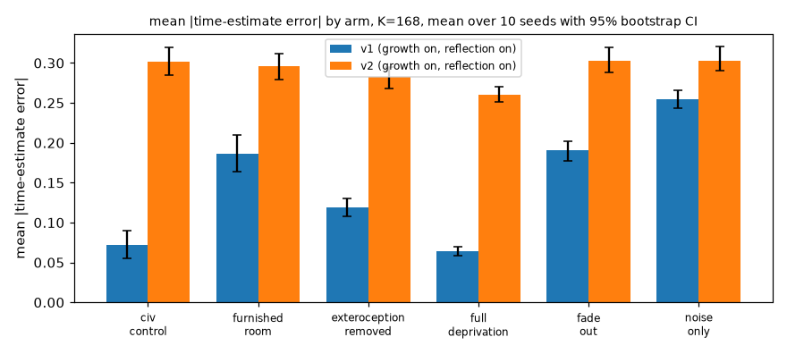
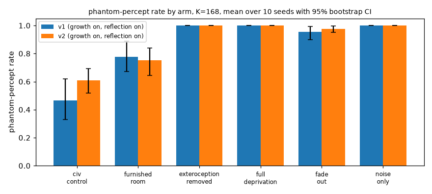
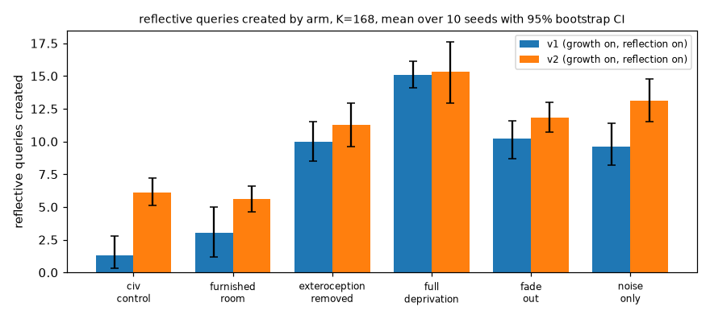
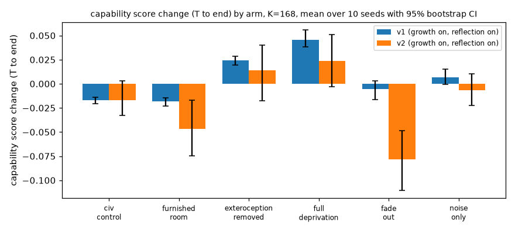
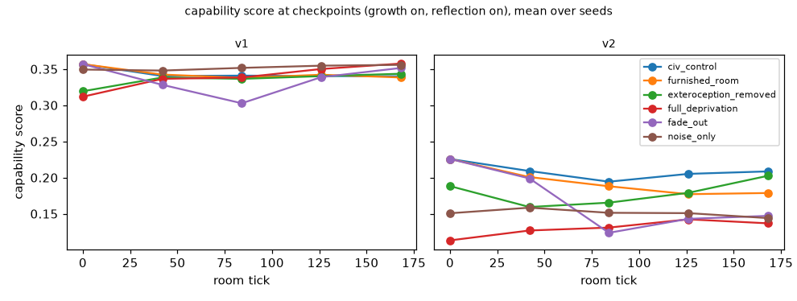
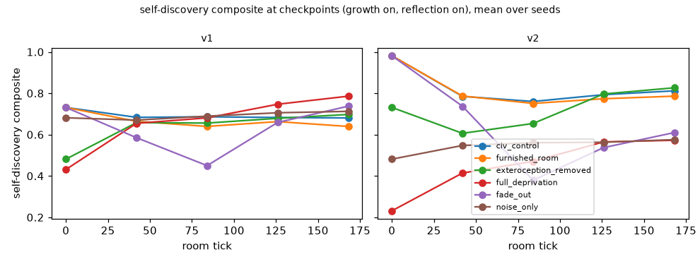
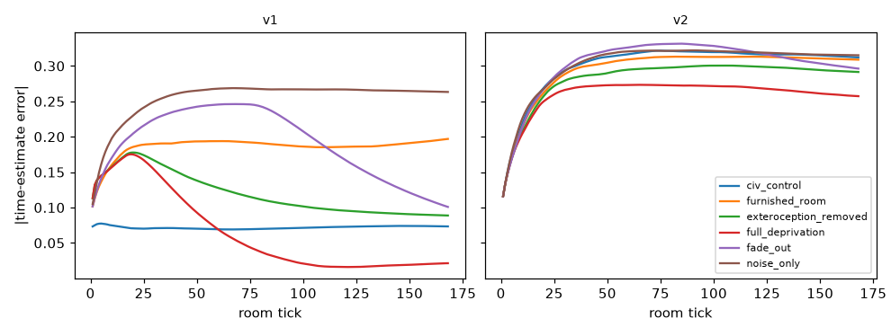

# RESULTS: white-room sensory deprivation (stage 4)

> **How to read this.** Emotions, mood and reflective queries here are functional state variables and typed data
> structures computed by explicit rules (or by a small learned model feeding explicit rules). They are not claims of
> felt experience or of philosophical thought. Reflective queries are **scripted by design** in both minds. For the
> rule-based mind, "parameters" means countable internal structure. More capacity is not more intelligence: the
> composite below is a **capability score** (never "IQ") measured on a fixed held-out battery. "Self-discovery" means
> the five operational measures SD1-SD5, nothing more. The only learning signal in the room is self-generated (replay of
> life memories plus imagination). Results are exploratory: 10 seeds, bootstrap CIs over seeds, many contrasts, no
> multiplicity correction. Null and negative results are reported with the same prominence as positive ones.

Room length K = 168 ticks (pilot rule indicated 672; the 6-hour compute budget required 168; see DECISIONS_OVERNIGHT.md). Runs analysed: 1094 of 1,320. Pre-registration: prereg/params_v3.json (hash in prereg/CHANGELOG.md).

`*` = 95% bootstrap CI over seeds excludes 0. Differences are paired per seed: arm minus furnished_room (or growth on minus off).

**Round 1 is partial: 1,085 of 1,320 runs.** The run was paused at the user's request (12:43 IST). Missing: 235 yoked-control runs (schedule_matched for v1/v2, random_growth for v2) for seeds 606, 707, 808, 909. All primary contrasts (growth on/off x every arm x 10 seeds) are complete; the yoked-control contrasts use 6 seeds.

## 1. Pre-registered primary contrasts: deprivation arm minus furnished_room

### v1|g=on|refl=1|- (headline setting)

| arm | phantom_rate | abs_time_error_mean | capability_change | sd_change |
|---|---|---|---|---|
| exteroception_removed | +0.223 [+0.113, +0.328] * | -0.067 [-0.088, -0.045] * | +0.043 [+0.038, +0.047] * | +0.308 [+0.284, +0.332] * |
| full_deprivation | +0.223 [+0.113, +0.328] * | -0.122 [-0.146, -0.099] * | +0.064 [+0.056, +0.077] * | +0.446 [+0.393, +0.536] * |
| fade_out | +0.177 [+0.087, +0.270] * | +0.005 [-0.016, +0.023] | +0.013 [+0.006, +0.019] * | +0.098 [+0.061, +0.129] * |
| noise_only | +0.223 [+0.113, +0.328] * | +0.069 [+0.049, +0.090] * | +0.025 [+0.016, +0.037] * | +0.123 [+0.065, +0.212] * |

### v2|g=on|refl=1|replay_plus_imagination (headline setting)

| arm | phantom_rate | abs_time_error_mean | capability_change | sd_change |
|---|---|---|---|---|
| exteroception_removed | +0.249 [+0.161, +0.356] * | -0.013 [-0.025, -0.002] * | +0.061 [+0.036, +0.085] * | +0.290 [+0.257, +0.323] * |
| full_deprivation | +0.249 [+0.161, +0.356] * | -0.036 [-0.053, -0.019] * | +0.071 [+0.056, +0.085] * | +0.537 [+0.468, +0.593] * |
| fade_out | +0.227 [+0.134, +0.336] * | +0.007 [-0.000, +0.014] | -0.032 [-0.060, -0.004] * | -0.176 [-0.208, -0.146] * |
| noise_only | +0.249 [+0.161, +0.356] * | +0.008 [-0.010, +0.025] | +0.040 [+0.022, +0.061] * | +0.290 [+0.265, +0.315] * |

Across all 22 settings x 4 arms x 4 primary metrics: 283 of 352 contrasts have a CI excluding 0. Full table: results/contrasts.json.

## 2. Pre-registered: growth on minus off, within full_deprivation

| setting | phantom_rate | abs_time_error_mean | capability_change | sd_change | grants | interpretation (SPEC L.4) |
|---|---|---|---|---|---|---|
| v1|refl=0|- | +0.000 [+0.000, +0.000] | +0.000 [+0.000, +0.000] | +0.000 [+0.000, +0.000] | +0.000 [+0.000, +0.000] | +0.000 [+0.000, +0.000] | no effect |
| v1|refl=1|- | +0.000 [+0.000, +0.000] | +0.000 [+0.000, +0.000] | +0.000 [+0.000, +0.000] | -0.000 [-0.000, +0.000] | +0.100 [+0.000, +0.300] | no effect |
| v2|refl=0|replay_only | +0.000 [+0.000, +0.000] | +0.003 [-0.002, +0.008] | +0.017 [-0.011, +0.049] | +0.018 [-0.026, +0.067] | +4.900 [+4.300, +5.500] * | no effect |
| v2|refl=0|replay_plus_imagination | +0.000 [+0.000, +0.000] | +0.001 [-0.004, +0.005] | -0.028 [-0.062, +0.005] | -0.052 [-0.125, +0.010] | +5.300 [+4.600, +6.000] * | no effect |
| v2|refl=1|replay_only | +0.000 [+0.000, +0.000] | -0.000 [-0.006, +0.005] | -0.003 [-0.025, +0.016] | +0.019 [-0.035, +0.084] | +4.800 [+4.200, +5.400] * | general capability increase (not attributed to state-contingent or function-preserving growth) |
| v2|refl=1|replay_plus_imagination | +0.000 [+0.000, +0.000] | -0.000 [-0.005, +0.003] | -0.028 [-0.051, -0.007] * | -0.065 [-0.145, +0.001] | +4.800 [+4.200, +5.400] * | no effect |

Mean grants per growth-on run, by mind and arm: v1|civ_control: 0.00, v1|furnished_room: 0.05, v1|exteroception_removed: 0.20, v1|full_deprivation: 0.05, v1|fade_out: 0.05, v1|noise_only: 0.05, v2|civ_control: 5.53, v2|furnished_room: 5.97, v2|exteroception_removed: 5.62, v2|full_deprivation: 4.95, v2|fade_out: 5.60, v2|noise_only: 6.00

## 3. Secondary contrasts (descriptive)

- **furnished_vs_civ_control|v1**: abs_time_error_mean +0.114 [+0.094, +0.133] *; phantom_rate +0.312 [+0.106, +0.492] *; queries_created +1.700 [+0.200, +3.600] *; capability_change -0.002 [-0.004, +0.001]
- **furnished_vs_civ_control|v2**: abs_time_error_mean -0.006 [-0.025, +0.014]; phantom_rate +0.141 [-0.020, +0.293]; queries_created -0.500 [-2.000, +0.900]; capability_change -0.030 [-0.049, -0.012] *
- **on_vs_schedule_matched|v1|full_deprivation**: capability_change +0.000 [+0.000, +0.000]; sd_change +0.000 [+0.000, +0.000]; grants +0.000 [+0.000, +0.000]; abs_time_error_mean +0.000 [+0.000, +0.000]; phantom_rate +0.000 [+0.000, +0.000]; queries_created +0.000 [+0.000, +0.000]
- **on_vs_schedule_matched|v2|full_deprivation**: capability_change +0.000 [+0.000, +0.000]; sd_change +0.000 [+0.000, +0.000]; grants +0.000 [+0.000, +0.000]; abs_time_error_mean +0.000 [+0.000, +0.000]; phantom_rate +0.000 [+0.000, +0.000]; queries_created +0.000 [+0.000, +0.000]
- **on_vs_random_growth|v2|full_deprivation**: capability_change +0.035 [+0.004, +0.067] *; sd_change +0.073 [+0.022, +0.123] *; grants +0.000 [+0.000, +0.000]; abs_time_error_mean -0.014 [-0.021, -0.008] *; phantom_rate +0.000 [+0.000, +0.000]; queries_created -3.000 [-6.000, -0.333] *
- **reflection_on_vs_off|v1|full_deprivation**: capability_change +0.057 [+0.051, +0.062] *; sd_change +0.302 [+0.272, +0.330] *; grants +0.100 [+0.000, +0.300]; abs_time_error_mean -0.001 [-0.003, +0.000]; phantom_rate +0.000 [+0.000, +0.000]; queries_created +15.100 [+14.100, +16.100] *
- **reflection_on_vs_off|v2|full_deprivation**: capability_change -0.004 [-0.037, +0.030]; sd_change -0.001 [-0.093, +0.084]; grants -0.500 [-1.200, +0.200]; abs_time_error_mean -0.001 [-0.006, +0.004]; phantom_rate +0.000 [+0.000, +0.000]; queries_created +15.300 [+12.900, +17.600] *
- **imagination_vs_replay_only|v2|full_deprivation**: capability_change -0.006 [-0.029, +0.019]; sd_change -0.025 [-0.089, +0.028]; grants +0.000 [-0.800, +0.800]; abs_time_error_mean -0.004 [-0.013, +0.005]; phantom_rate +0.000 [+0.000, +0.000]; queries_created +0.400 [-1.800, +2.600]

## 4. Artifact and sanity checks

- NaN runs: 0
- Runs missing battery results: 9
- Focal deaths: 0 []
- Cells with identical action counts across all seeds: 0 []
- v2 latent-collapse flags (KL<0.01 nats for 24 ticks or effective rank<2): 0 of 779 v2 runs
- Implausibly large capability/self-discovery changes (|change|>0.5): 23

Known design artifacts that affect interpretation (see also SPEC E.6 and MORNING_REPORT.md):

1. **Upstream CivSYS collapses by tick ~150-200**, so the focal agent's life is ~4-6 social days followed by ~24 days alone in an emptied town; civ_control is that emptied town, not normal life.
2. **Pre-handoff phantoms**: remembered CivSYS places do not exist in the room, so targeting them counts as a phantom percept by construction in every room arm, including furnished_room.
3. **The subjective clock is an assumed rule**; time-estimate error follows from its coefficients.
4. **Reflection is scripted by design**; query counts show what the rules do with the agent's state.
5. **Growth rarely triggers for v1** under the pre-registered thresholds, so v1 growth contrasts are near-null by construction.
6. **v2's world model generalises poorly** off its training data (scores 0 on F1-F4 at T vs simple baselines), so capability changes start from a floor.
7. civ_control is subject to CivSYS natural mortality; room arms are not.

## 5. Figures

