# RESULTS, ROUND 2: round 1 vs round 2 on the same metrics

> **How to read this.** Emotions, mood and reflective queries here are functional state variables and typed data
> structures computed by explicit rules (or by a small learned model feeding explicit rules). They are not claims of
> felt experience or of philosophical thought. Reflective queries are **scripted by design** in both minds. For the
> rule-based mind, "parameters" means countable internal structure. More capacity is not more intelligence: the
> composite below is a **capability score** (never "IQ") measured on a fixed held-out battery. "Self-discovery" means
> the five operational measures SD1-SD5, nothing more. The only learning signal in the room is self-generated (replay of
> life memories plus imagination). Results are exploratory: 10 seeds, bootstrap CIs over seeds, many contrasts, no
> multiplicity correction. Null and negative results are reported with the same prominence as positive ones.

Round 2 runs analysed: 1055 of 1,320. Round 1: partial run (tag `round1-final`). `*` = 95% bootstrap CI over seeds excludes 0; differences are paired per seed.

Provisional: the full run stopped at 1,054/1,320 (the process was killed externally on 2026-10-15). Phase A (growth on/off, 660 runs) is complete; yoked controls (schedule_matched, random_growth) are 394/660, so the on-vs-schedule and on-vs-random contrasts use fewer seeds.

## 0. What changed in round 2

| | Round 1 | Round 2 |
|---|---|---|
| Handoff tick T | 720 (day 30; civilisation dead from ~day 6) | **80** (day 3.3; before any perceivable death in all seeds) |
| Life history | ~4-6 social days + ~24 days alone in an emptied town | 3.3 social days, everyone alive |
| Death information reaching the focal mind | none by construction, but an own-alive column, starvation threshold and absence-triggered 'grief' rule existed | removed behind `death_isolation`; tested |
| civ_control length | 168 ticks in an emptied town | stops before the first perceivable death (see section 4) |
| v2 training data | 672 focal transitions | ~12,400 transitions (all non-held-out agents of the seed, pre-T) |
| v2 surprise baseline | in-sample (last 48 life ticks) | out-of-sample (held-out agents), threshold from held-out windows |
| v1 growth thresholds | PE 0.4, boredom 0.5, novelty 0.2 | recalibrated on furnished-room runs to ~1 grant per run (post-hoc, logged) |

## 1. Primary contrasts (deprivation arm minus furnished_room), headline settings

### v1|g=on|refl=1|-

| arm | metric | round 1 | round 2 |
|---|---|---|---|
| exteroception_removed | phantom_rate | +0.223 [+0.113, +0.328] * | +0.264 [+0.140, +0.395] * |
| exteroception_removed | abs_time_error_mean | -0.067 [-0.088, -0.045] * | -0.114 [-0.127, -0.101] * |
| exteroception_removed | capability_change | +0.043 [+0.038, +0.047] * | +0.027 [+0.016, +0.038] * |
| exteroception_removed | sd_change | +0.308 [+0.284, +0.332] * | +0.277 [+0.231, +0.324] * |
| full_deprivation | phantom_rate | +0.223 [+0.113, +0.328] * | +0.264 [+0.140, +0.395] * |
| full_deprivation | abs_time_error_mean | -0.122 [-0.146, -0.099] * | -0.145 [-0.158, -0.131] * |
| full_deprivation | capability_change | +0.064 [+0.056, +0.077] * | +0.052 [+0.034, +0.071] * |
| full_deprivation | sd_change | +0.446 [+0.393, +0.536] * | +0.465 [+0.323, +0.615] * |
| fade_out | phantom_rate | +0.177 [+0.087, +0.270] * | +0.245 [+0.119, +0.381] * |
| fade_out | abs_time_error_mean | +0.005 [-0.016, +0.023] | +0.033 [+0.021, +0.046] * |
| fade_out | capability_change | +0.013 [+0.006, +0.019] * | -0.030 [-0.042, -0.017] * |
| fade_out | sd_change | +0.098 [+0.061, +0.129] * | -0.090 [-0.136, -0.040] * |
| noise_only | phantom_rate | +0.223 [+0.113, +0.328] * | +0.264 [+0.140, +0.395] * |
| noise_only | abs_time_error_mean | +0.069 [+0.049, +0.090] * | +0.082 [+0.057, +0.111] * |
| noise_only | capability_change | +0.025 [+0.016, +0.037] * | +0.019 [-0.005, +0.045] |
| noise_only | sd_change | +0.123 [+0.065, +0.212] * | +0.100 [-0.048, +0.259] |

### v2|g=on|refl=1|replay_plus_imagination

| arm | metric | round 1 | round 2 |
|---|---|---|---|
| exteroception_removed | phantom_rate | +0.249 [+0.161, +0.356] * | +0.185 [+0.066, +0.326] * |
| exteroception_removed | abs_time_error_mean | -0.013 [-0.025, -0.002] * | -0.006 [-0.028, +0.014] |
| exteroception_removed | capability_change | +0.061 [+0.036, +0.085] * | +0.039 [+0.029, +0.048] * |
| exteroception_removed | sd_change | +0.290 [+0.257, +0.323] * | +0.260 [+0.242, +0.283] * |
| full_deprivation | phantom_rate | +0.249 [+0.161, +0.356] * | +0.185 [+0.066, +0.326] * |
| full_deprivation | abs_time_error_mean | -0.036 [-0.053, -0.019] * | -0.083 [-0.112, -0.057] * |
| full_deprivation | capability_change | +0.071 [+0.056, +0.085] * | +0.092 [+0.080, +0.108] * |
| full_deprivation | sd_change | +0.537 [+0.468, +0.593] * | +0.645 [+0.590, +0.707] * |
| fade_out | phantom_rate | +0.227 [+0.134, +0.336] * | +0.145 [+0.032, +0.272] * |
| fade_out | abs_time_error_mean | +0.007 [-0.000, +0.014] | +0.021 [+0.004, +0.037] * |
| fade_out | capability_change | -0.032 [-0.060, -0.004] * | -0.035 [-0.046, -0.022] * |
| fade_out | sd_change | -0.176 [-0.208, -0.146] * | -0.168 [-0.206, -0.120] * |
| noise_only | phantom_rate | +0.249 [+0.161, +0.356] * | +0.185 [+0.066, +0.326] * |
| noise_only | abs_time_error_mean | +0.008 [-0.010, +0.025] | +0.054 [+0.024, +0.082] * |
| noise_only | capability_change | +0.040 [+0.022, +0.061] * | +0.024 [+0.004, +0.043] * |
| noise_only | sd_change | +0.290 [+0.265, +0.315] * | +0.305 [+0.280, +0.340] * |

Primary contrasts with CI excluding 0: round 1 283/352, round 2 290/352.

## 2. Growth on minus off within full_deprivation

| setting | metric | round 1 | round 2 |
|---|---|---|---|
| v1|refl=0|- | grants | +0.000 [+0.000, +0.000] | +3.600 [+3.300, +3.900] * |
| v1|refl=0|- | phantom_rate | +0.000 [+0.000, +0.000] | +0.000 [+0.000, +0.000] |
| v1|refl=0|- | abs_time_error_mean | +0.000 [+0.000, +0.000] | +0.008 [-0.000, +0.016] |
| v1|refl=0|- | capability_change | +0.000 [+0.000, +0.000] | +0.000 [+0.000, +0.000] |
| v1|refl=0|- | sd_change | +0.000 [+0.000, +0.000] | -0.001 [-0.002, +0.000] |
| v1|refl=1|- | grants | +0.100 [+0.000, +0.300] | +3.700 [+3.300, +4.100] * |
| v1|refl=1|- | phantom_rate | +0.000 [+0.000, +0.000] | +0.000 [+0.000, +0.000] |
| v1|refl=1|- | abs_time_error_mean | +0.000 [+0.000, +0.000] | +0.008 [+0.000, +0.016] * |
| v1|refl=1|- | capability_change | +0.000 [+0.000, +0.000] | +0.000 [-0.002, +0.004] |
| v1|refl=1|- | sd_change | -0.000 [-0.000, +0.000] | +0.002 [-0.011, +0.020] |
| v2|refl=0|replay_only | grants | +4.900 [+4.300, +5.500] * | +0.000 [+0.000, +0.000] |
| v2|refl=0|replay_only | phantom_rate | +0.000 [+0.000, +0.000] | +0.000 [+0.000, +0.000] |
| v2|refl=0|replay_only | abs_time_error_mean | +0.003 [-0.002, +0.008] | +0.000 [+0.000, +0.000] |
| v2|refl=0|replay_only | capability_change | +0.017 [-0.011, +0.049] | +0.000 [+0.000, +0.000] |
| v2|refl=0|replay_only | sd_change | +0.018 [-0.026, +0.067] | +0.000 [+0.000, +0.000] |
| v2|refl=0|replay_plus_imagination | grants | +5.300 [+4.600, +6.000] * | +0.000 [+0.000, +0.000] |
| v2|refl=0|replay_plus_imagination | phantom_rate | +0.000 [+0.000, +0.000] | +0.000 [+0.000, +0.000] |
| v2|refl=0|replay_plus_imagination | abs_time_error_mean | +0.001 [-0.004, +0.005] | +0.000 [+0.000, +0.000] |
| v2|refl=0|replay_plus_imagination | capability_change | -0.028 [-0.062, +0.005] | +0.000 [+0.000, +0.000] |
| v2|refl=0|replay_plus_imagination | sd_change | -0.052 [-0.125, +0.010] | +0.000 [+0.000, +0.000] |
| v2|refl=1|replay_only | grants | +4.800 [+4.200, +5.400] * | +1.600 [+1.000, +2.200] * |
| v2|refl=1|replay_only | phantom_rate | +0.000 [+0.000, +0.000] | +0.000 [+0.000, +0.000] |
| v2|refl=1|replay_only | abs_time_error_mean | -0.000 [-0.006, +0.005] | -0.001 [-0.002, +0.000] |
| v2|refl=1|replay_only | capability_change | -0.003 [-0.025, +0.016] | +0.004 [-0.000, +0.009] |
| v2|refl=1|replay_only | sd_change | +0.019 [-0.035, +0.084] | +0.021 [+0.001, +0.049] * |
| v2|refl=1|replay_plus_imagination | grants | +4.800 [+4.200, +5.400] * | +1.400 [+0.800, +2.000] * |
| v2|refl=1|replay_plus_imagination | phantom_rate | +0.000 [+0.000, +0.000] | +0.000 [+0.000, +0.000] |
| v2|refl=1|replay_plus_imagination | abs_time_error_mean | -0.000 [-0.005, +0.003] | +0.000 [-0.001, +0.001] |
| v2|refl=1|replay_plus_imagination | capability_change | -0.028 [-0.051, -0.007] * | +0.002 [-0.004, +0.008] |
| v2|refl=1|replay_plus_imagination | sd_change | -0.065 [-0.145, +0.001] | +0.007 [-0.024, +0.039] |

| setting | interpretation round 1 | interpretation round 2 |
|---|---|---|
| v1|refl=0|- | no effect | no effect |
| v1|refl=1|- | no effect | no effect |
| v2|refl=0|replay_only | no effect | no effect |
| v2|refl=0|replay_plus_imagination | no effect | no effect |
| v2|refl=1|replay_only | general capability increase (not attributed to state-contingent or function-preserving growth) | self-discovery-like (not attributed to state-contingent or function-preserving growth) |
| v2|refl=1|replay_plus_imagination | no effect | general capability increase (not attributed to state-contingent or function-preserving growth) |

## 3. Growth firing rates (mean grants per growth-on run)

| mind | arm | round 1 | round 2 |
|---|---|---|---|
| v1 | civ_control | 0.00 | 0.00 |
| v1 | furnished_room | 0.05 | 0.80 |
| v1 | exteroception_removed | 0.20 | 3.95 |
| v1 | full_deprivation | 0.05 | 3.65 |
| v1 | fade_out | 0.05 | 4.10 |
| v1 | noise_only | 0.05 | 4.00 |
| v2 | civ_control | 5.53 | 0.00 |
| v2 | furnished_room | 5.97 | 0.47 |
| v2 | exteroception_removed | 5.62 | 0.57 |
| v2 | full_deprivation | 4.95 | 0.75 |
| v2 | fade_out | 5.60 | 1.05 |
| v2 | noise_only | 6.00 | 2.48 |

## 4. Capability at T and the civ_control window

- v1: mean capability score at T (furnished_room, growth on): round 1 0.357, round 2 0.376; F1 at end: round 1 0.004, round 2 0.018
- v2: mean capability score at T (furnished_room, growth on): round 1 0.226, round 2 0.399; F1 at end: round 1 0.016, round 2 0.044
- civ_control window (round 2): mean 4.3 ticks, min 2, max 13 (n=180 runs), versus 168 room ticks. Contrasts involving civ_control compare a 4-tick window with a 168-tick one and are reported descriptively only; furnished_room is the primary comparison arm.

### v2 held-out baseline gate (round 2)

| seed | attempt | model MSE | persistence MSE | ratio | beats |
|---|---|---|---|---|---|
| 42 | 3 | 0.0513 | 0.0529 | 0.97 | True |
| 101 | 3 | 0.1179 | 0.1239 | 0.95 | True |
| 202 | 3 | 0.0969 | 0.0974 | 0.99 | True |
| 303 | 3 | 0.0815 | 0.0824 | 0.99 | True |
| 404 | 3 | 0.1315 | 0.1432 | 0.92 | True |
| 1010 | 3 | 0.0810 | 0.0942 | 0.86 | True |
| 606 | 3 | 0.0730 | 0.0798 | 0.92 | True |
| 707 | 3 | 0.1205 | 0.1312 | 0.92 | True |
| 808 | 3 | 0.0824 | 0.0948 | 0.87 | True |
| 909 | 3 | 0.0100 | 0.0110 | 0.91 | True |

## 5. Round-2 artifact and sanity checks

- NaN runs: 0; missing battery: 1; focal deaths: 0
- Cells identical across all seeds: 0
- v2 latent-collapse flags: 0 of 747
- Implausibly large capability/self-discovery changes: 37

## 6. Figures

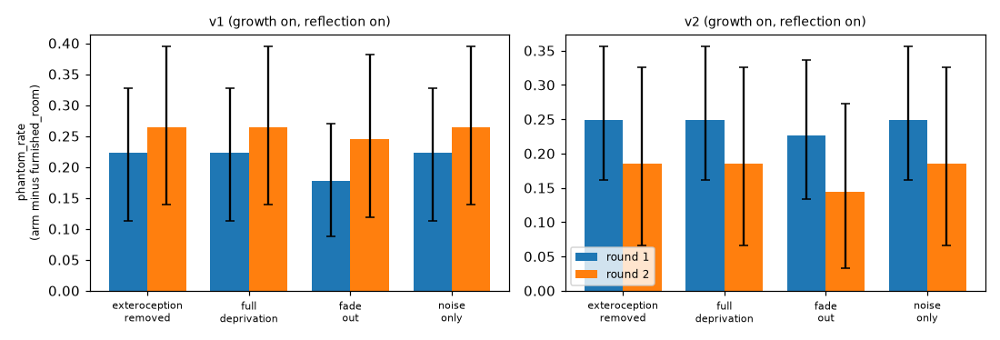
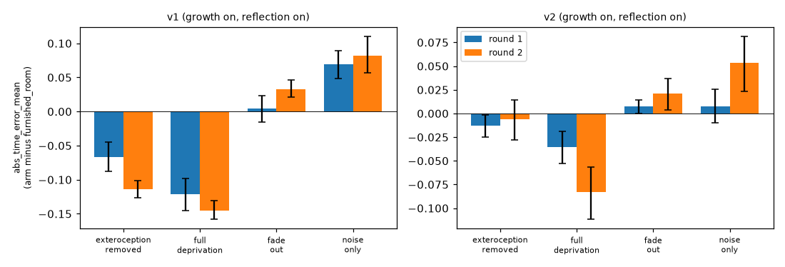
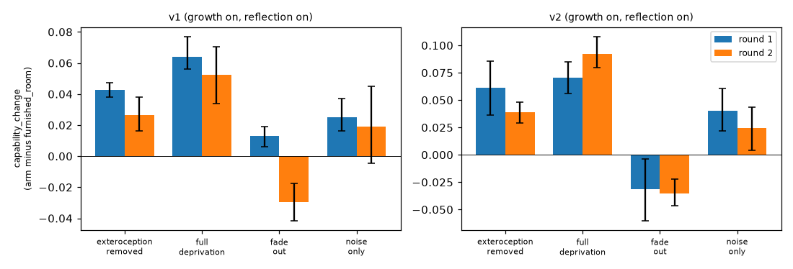
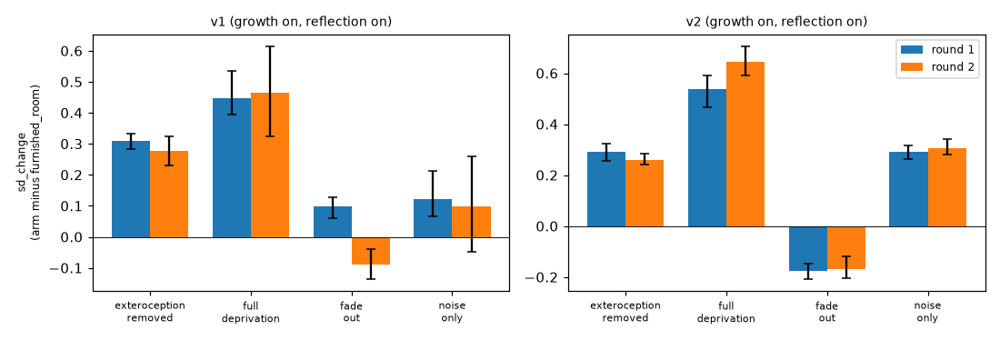
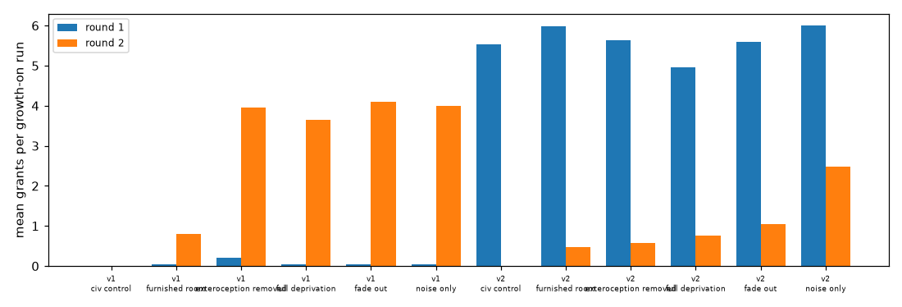
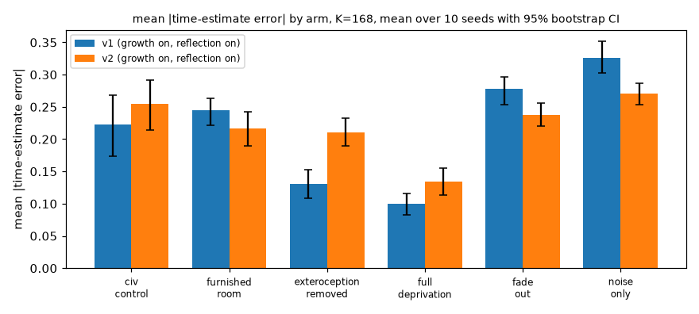
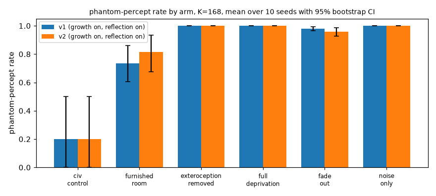
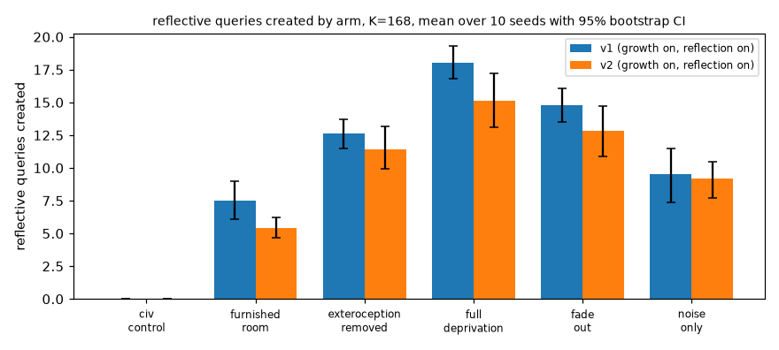
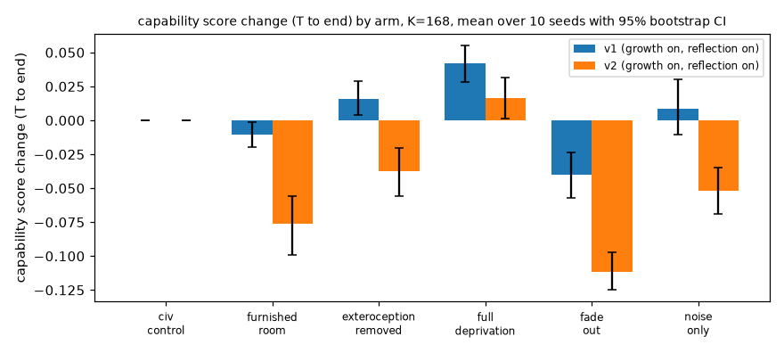
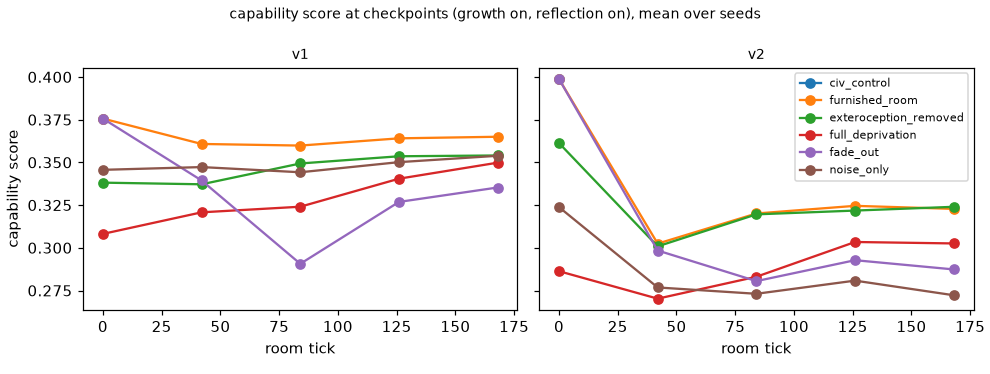
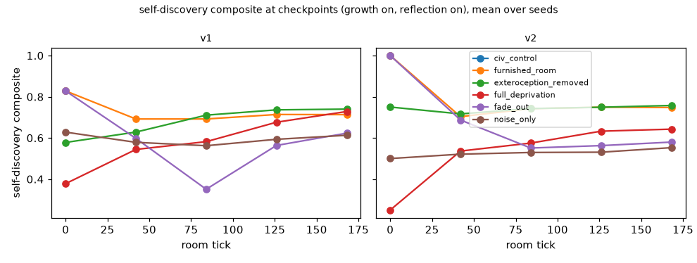
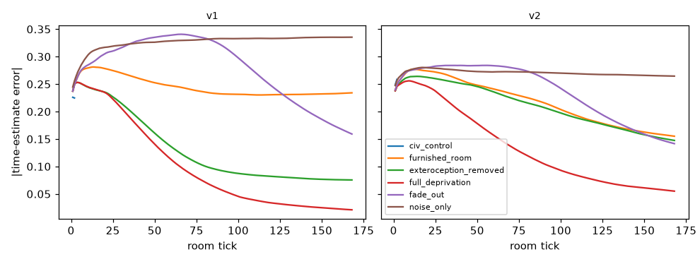
